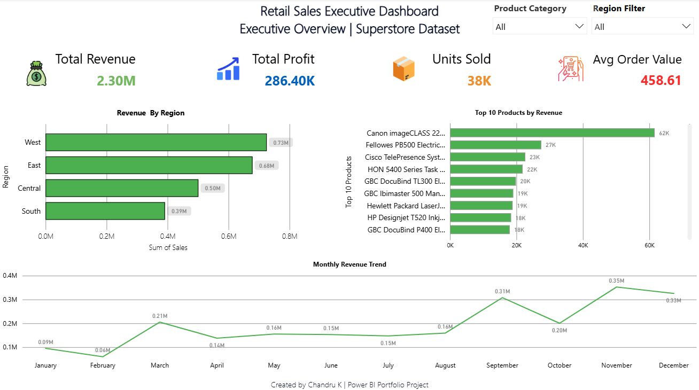
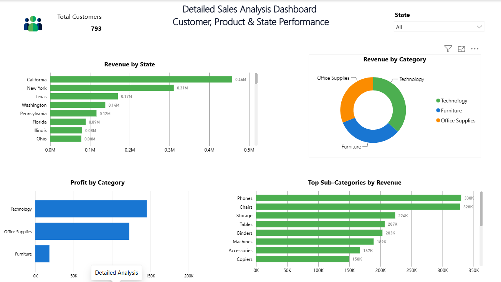

# Retail Sales Data Warehouse and Executive Dashboard (SQL + Power BI)

An end-to-end retail analytics project: raw Superstore data (Kaggle) is
cleaned, loaded into a SQL data warehouse, analysed with SQL queries, and
presented in an interactive Power BI executive dashboard.

## Business problem
Retail managers need a single view of sales, profit and regional
performance to decide where to grow and what to fix.

## Workflow
1. **Data cleaning:** removed duplicates, fixed data types and handled missing values in Python ([`data_cleaning.ipynb`](python/data_cleaning.ipynb))
2. **Data warehouse:** created tables and loaded cleaned data with SQL ([`create_tables.sql`](sql/create_tables.sql))
3. **Analysis:** wrote SQL queries for sales, profit and customer insights ([`Sales_analysis_queries.sql`](sql/Sales_analysis_queries.sql))
4. **Dashboard:** built an executive dashboard in Power BI ([`Retail_Sales_Executive_Dashboard.pbix`](powerbi/Retail_Sales_Executive_Dashboard.pbix))

## Dashboard preview

## Key insights
- **Total revenue:** $2.30M, with a total profit of $286.4K (about 12.4% margin)
- **Units sold:** 38K, with an average order value of $458.61
- **Top region:** West leads with $0.73M, followed by East ($0.68M). South is lowest at $0.39M.
- **Top state:** California generates the most revenue ($0.46M), followed by New York ($0.31M).
- **Top category:** Technology earns the highest profit.
- **Weakest category:** Furniture has the lowest profit of the three categories despite strong sales.
- **Top sub-categories by revenue:** Phones ($330K) and Chairs ($328K).
- **Customers:** 793 total customers.

## Tools used
Python (pandas), SQL, Power BI, Excel/CSV

## Files
| File | Purpose |
|---|---|
| `superstore_raw.csv.csv` | Original dataset |
| `cleaned_superstore.csv` | Cleaned dataset |
| `data_cleaning.ipynb` | Cleaning steps |
| `sql/create_tables.sql` | Warehouse table creation |
| `Sales_analysis_queries.sql` | Analysis queries |
| `Retail Sales Executive Dashboard.pbix` | Power BI dashboard |
